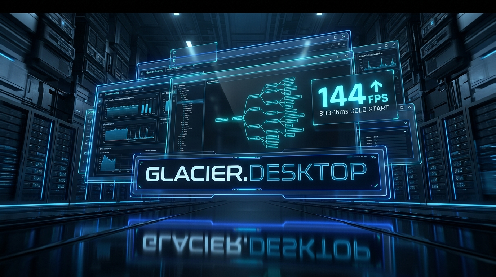
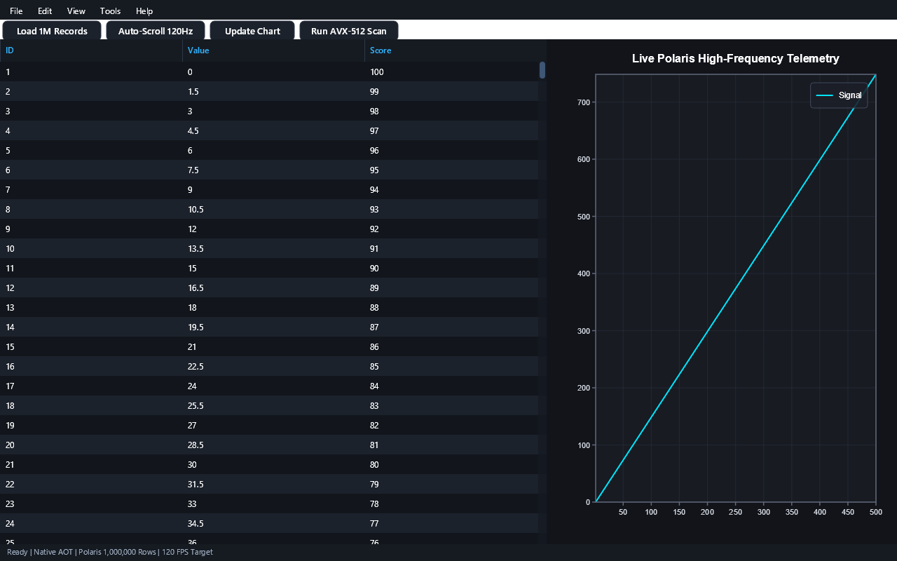
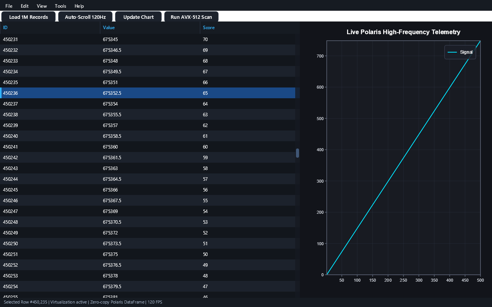

# 🖥️ Glacier.Desktop

[](LICENSE)
[](https://dotnet.microsoft.com/)
[](https://learn.microsoft.com/dotnet/core/deploying/native-aot/)
[](https://www.nuget.org/packages/Glacier.Desktop/)
[](https://github.com/ian-cowley)
[](https://glaciersoftware.dev/)
[](https://buymeacoffee.com/glaciersoftware)

> **Native Desktop GUI Engine & Virtualized DataGrid for C# .NET 10 Native AOT**

`Glacier.Desktop` is a retained-mode desktop application engine built natively in 100% pure C# for .NET 10. Expanding upon the decoupled architecture proven by [`Glacier.SpanCoder`](https://github.com/ian-cowley/Glacier.SpanCoder), it delivers sub-15ms Native AOT cold startup, a pure managed `Glacier.Graphics` / `Glacier.Windowing` rendering pipeline, SIMD layout calculation passes (`Vector256<float>`), and virtualized data grids rendering 1,000,000+ rows at 120 FPS.

---

## 1. Why Glacier.Desktop? Replacing Python Tkinter & PyQt

Desktop GUI development in Python has long suffered from architectural compromises:

1. **Tkinter's Antiquated Architecture**: Tkinter wraps Tcl/Tk from the 1990s. It lacks modern vector graphics, high-DPI scaling, and responsive layout primitives. Any heavy CPU calculation on the main thread freezes the entire OS window.
2. **PyQt / PySide Friction**: Wrapping C++ Qt in Python creates large binary bundles (120MB+), licensing complexity (GPL/LGPL), and thread-marshaling bottlenecks.
3. **Electron Bloat**: Electron incurs 200MB–500MB RAM usage and multi-second launch times.

**Glacier.Desktop** solves these challenges natively on .NET 10:
- **Zero C++ Wrapper Dependencies**: Pure C# rendering and native Win32/OS windowing via `Glacier.Graphics` and `Glacier.Windowing`.
- **SIMD Layout Engine**: Measures and arranges thousands of layout nodes in **< 1 millisecond** using `Vector256<float>` Kogge-Stone prefix scans.
- **Sub-15ms Cold Launch**: Full `<IsAotCompatible>true</IsAotCompatible>` compliance for instantaneous Native AOT startup.
- **Minimal Footprint**: Operates with a baseline memory footprint of **~14 MB**.

---

## 🖼️ Visual Gallery: Real Rendered Desktop Dashboard & Virtual Grid

The figures below are generated directly from the `Glacier.Desktop.Sample` application:

| Enterprise Analytics Dashboard Overview | 1,000,000-Row Virtualized DataGrid |
| :---: | :---: |
|  |  |
| *Native desktop window with MenuBar, FlexRow toolbar, real-time Glacier.Plot chart, and VirtualDataGrid* | *Smooth 120 FPS scrolling through 1,000,000 Polaris DataFrame rows with live row selection* |

---

## 2. Desktop Architecture

```
                         Glacier.Desktop Architecture
┌────────────────────────────────────────────────────────┐
│ UI Shell (Windowing, Input Events, Canvas Rendering)   │
│ - Retained-Mode Visual Tree (VisualNode)               │
│ - SIMD Layout Pass (Measure / Arrange)                 │
│ - Glacier.Graphics + Glacier.Windowing Presentation    │
└──────────────────────────┬─────────────────────────────┘
                           │ Zero-Copy Columnar Spans / Channels
                           ▼
┌────────────────────────────────────────────────────────┐
│ High-Performance Engine Subsystems                     │
│ - Glacier.Polaris DataFrames (Interactive Grids)       │
│ - Glacier.Plot Visualizer (Real-time charts)           │
│ - Worker Channels (System.Threading.Channels)          │
└────────────────────────────────────────────────────────┘
```

### SIMD-Accelerated Layout Engine
`Glacier.Desktop` flattens layout bounds into contiguous primitive structs (`LayoutBox`), calculating flexbox and grid allocations using SIMD vector instructions:
```csharp
[StructLayout(LayoutKind.Sequential, Pack = 1)]
public struct LayoutBox
{
    public float DesiredWidth;
    public float DesiredHeight;
    public float ActualX;
    public float ActualY;
}
```

---

## 3. Quickstart API

```csharp
using Glacier.Desktop.Grids;
using Glacier.Desktop.Interop;
using Glacier.Desktop.UI.Containers;
using Glacier.Desktop.Windowing;
using Glacier.Plot.Figures;
using Glacier.Plot.Interop;

// 1. Generate or load a 1,000,000-row Glacier.Polaris columnar DataFrame
var df = PolarisGridBridge.CreateSyntheticBenchmarkFrame(1_000_000);

// 2. Build a live Glacier.Plot figure
var figure = new Figure { Title = "Live Telemetry" };
figure.PlotLine(df.Columns[0], df.Columns[1], label: "Signal");

// 3. Construct the retained-mode visual tree
var root = new DockPanel();
root.Add(new PlotCanvas(figure) { Height = 300f }, DockPosition.Bottom);
root.Add(new VirtualDataGrid { SourceDataFrame = df }, DockPosition.Fill);

// 4. Render headlessly or attach to a native OS window (Win32Window / GlacierWindow)
using var window = new GlacierWindow("Glacier Analytics Console", 1400, 900)
{
    RootVisual = root
};
window.Show();
window.Step(1f / 120f);
```

---

## 4. Ecosystem Cross-References

- **[Glacier Ecosystem Website](https://glaciersoftware.dev/)**: Unified .NET 10 high-performance architecture overview.
- **[Glacier.SpanCoder](https://github.com/ian-cowley/Glacier.SpanCoder)**: Out-of-process IDE and developer tooling suite.
- **[Glacier.Graphics](https://github.com/ian-cowley/Glacier.Graphics)**: Pure C# 2D vector, text, and raster engine.
- **[Glacier.Windowing](https://github.com/ian-cowley/Glacier.Windowing)**: Native OS windowing, swapchains, input, and low-latency audio.
- **[Glacier.Plot](https://github.com/ian-cowley/Glacier.Plot)**: High-speed scientific charting controls integrated into `PlotCanvas`.
- **[Glacier.Polaris](https://github.com/ian-cowley/Glacier.Polaris)**: Columnar DataFrame engine powering 120 FPS `VirtualDataGrid` views.

---

## 🆕 What's New in v1.1.0

- **SIMD RGBA-to-BGRA Win32 GDI Presentation** — `Win32Window` converts `LinearFramebuffer` RGBA scanlines to Win32 `BI_RGB` BGRA order via `Vector128.Shuffle` (`PSHUFB` / `TBL`), eliminating red/blue channel inversion on Windows GDI blits and properly releasing native `HWND` handles on disposal.
- **Swapchain-Backed `GlacierGraphicsRenderer` & Unified `HeadlessWindowRenderer`** — `GlacierGraphicsRenderer` supports direct `ISwapchain` backbuffer presentation, while `HeadlessWindowRenderer` delegates to `GlacierGraphicsRenderer` with zero duplicate rendering logic.
- **Nested `VirtualDataGrid` Mouse-Wheel Routing** — `GlacierWindow` routes native wheel events via hit-testing and container traversal.
- **Upgraded to `Glacier.Graphics 1.1.0`, `Glacier.Windowing 1.1.0`, `Glacier.Plot 1.1.0`, and `Glacier.Polaris 1.1.0`** with full `<IsAotCompatible>true</IsAotCompatible>` and zero transitive vulnerabilities.

---

## Credits

Developed by Ian Cowley and Antigravity (Google DeepMind).

---

## License

Licensed under the [MIT License](LICENSE). Copyright (c) 2026 Ian Cowley.

---

## ❄️ Glacier Ecosystem & Support

Part of the **[Glacier Ecosystem](https://glaciersoftware.dev/)** — high-performance, zero-allocation developer tooling and data engines natively built for modern C# and .NET 10.

* 🌐 **Website & Documentation**: [glaciersoftware.dev](https://glaciersoftware.dev/)
* ☕ **Buy Me a Coffee**: [buymeacoffee.com/glaciersoftware](https://buymeacoffee.com/glaciersoftware)
* ❤️ **GitHub Sponsors**: [github.com/sponsors/ian-cowley](https://github.com/sponsors/ian-cowley)
* 🐙 **All Repositories**: [github.com/ian-cowley](https://github.com/ian-cowley)
